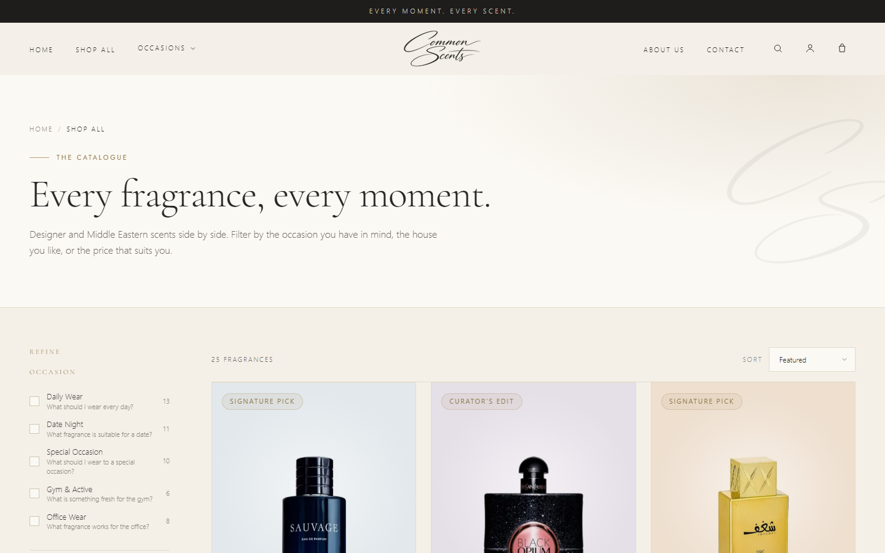
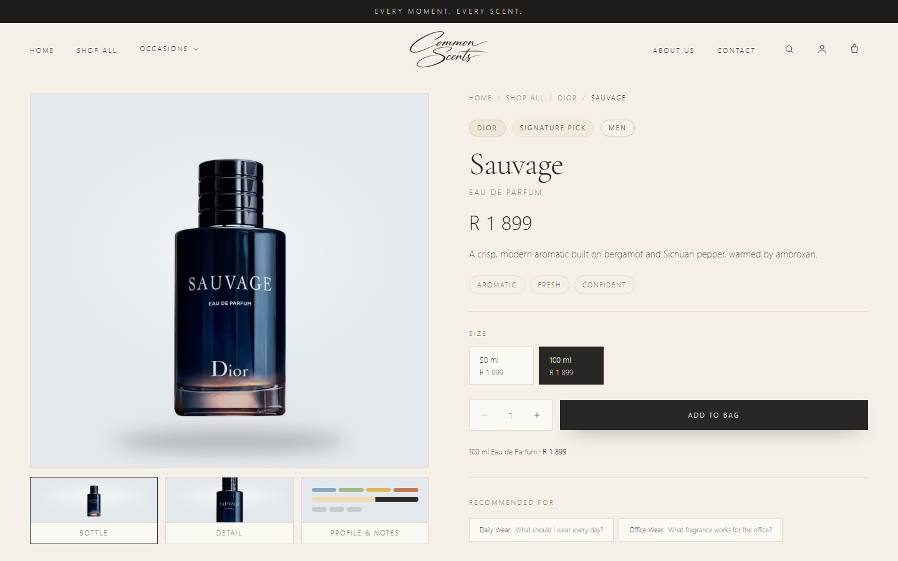
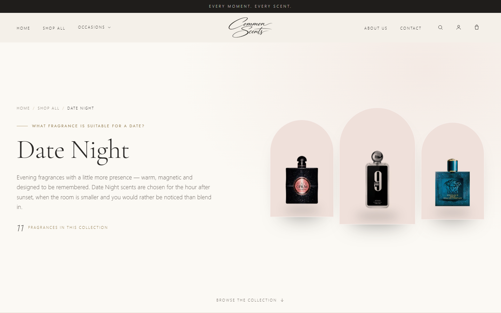
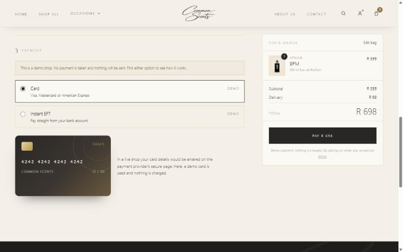
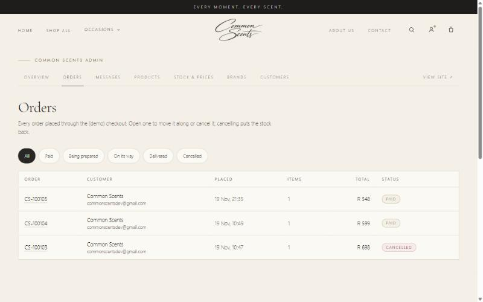
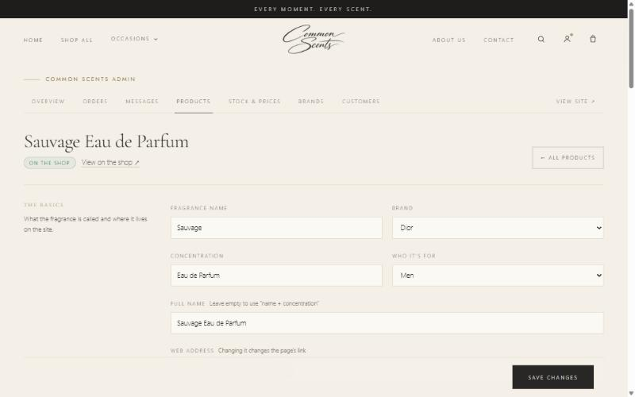

# Common Scents

[](https://github.com/sohumsingh/common-scents/actions/workflows/ci.yml)

**Every Moment. Every Scent.**

An online fragrance store for South Africa, built around a simple idea: people find it easier to choose a scent for a *moment* — a date, the office, the gym — than from a wall of brands.

**🌐 Live site: [commonscents.vercel.app](https://commonscents.vercel.app)**

> **Portfolio project.** Everything works end to end — accounts, stock, checkout, orders and an admin dashboard — but payments are simulated, so no money is ever taken and nothing is shipped. Products and prices are for demonstration only.


---

## ✨ What it does

### For shoppers
- **Shop by occasion.** Five collections — Daily Wear, Date Night, Special Occasion, Gym & Active and Office Wear — sit at the centre of the store. Gender and brand are secondary filters.
- **Filter, sort and search.** Filter by occasion, gender, brand and price; sort by featured, newest or price; search by name, brand, note or occasion from anywhere on the site.
- **Signature scent finder.** Four quick questions (the moment, the character, the intensity and the budget) match you to fragrances from the live catalogue.
- **Detailed product pages.** Sizes and prices, notes, character, a wear guide (seasons, day or night, longevity) and "also for this occasion" comparisons.
- **Real stock.** Sold-out sizes can't be bought, quantities stop at what's in stock, and low stock shows "Only 2 left".
- **A bag that just works.** Anyone can fill it without an account; it's re-checked against live prices and stock every visit.
- **Accounts.** Register, confirm your email, sign in, reset a forgotten password, and manage your name and newsletter preference.
- **Demo checkout.** Delivery details, three delivery options (standard, express or collection — standard is free over R1 500) and a simulated card or Instant EFT payment.
- **Order tracking.** A confirmation page, then each order's progress — Paid → Being prepared → On its way → Delivered — from your account.
- **Contact form.** Enquiries are saved for the team to answer, with spam protection.

### For the shop owner (admin dashboard)
- **Overview** — orders to send, demo sales, stock warnings, recent activity.
- **Orders** — move orders along or cancel them (cancelling puts the stock back).
- **Messages** — read and answer contact-form enquiries.
- **Products** — add, edit, hide or delete fragrances, including photo upload.
- **Stock & prices** — update every size in one place.
- **Brands** and **Customers** — manage brands and give or remove admin access.

Every change in the admin appears on the live shop straight away.

---

## 📸 Screenshots

| Shop | Product page |
|---|---|
|  |  |
| **Collection** | **About** |
|  |  |
| **Checkout (demo payment)** | **Admin: orders** |
|  |  |
| **Admin: product editor** | |
|  | |

---

## 💻 Built with

| | |
|---|---|
| **Framework** | [Next.js 16](https://nextjs.org) (App Router, Cache Components, Server Actions) with React 19 |
| **Language** | TypeScript (strict) |
| **Styling** | Tailwind CSS 4, with scroll-driven CSS animations |
| **Database & auth** | [Supabase](https://supabase.com) — PostgreSQL, Auth, Storage and row-level security |
| **Hosting** | [Vercel](https://vercel.com) — deploys automatically from `main`, server in London next to the database |
| **Email** | Supabase Auth over [Brevo](https://www.brevo.com) SMTP, with custom branded templates |
| **Testing & CI** | [Vitest](https://vitest.dev) unit tests, run with lint and type-checks by GitHub Actions on every push |

---

## 🛠️ How it works

**One source of truth.** Products, brands, stock, accounts, orders and enquiries all live in Postgres. Pages read the catalogue through a small service layer that caches it and refreshes the moment an admin saves a change.

**Security in the database, not just the UI.** Row-level security decides who can see what: customers see only their own orders, and only admins can read enquiries or edit the catalogue. The admin pages check access too, but the database is the final wall.

**A checkout that can't be cheated.** The browser only sends *which* sizes and *how many*. A single database function (`place_order`) then:
- looks up the real prices — never trusting the browser's;
- locks each size while it checks stock, so two people can't buy the last bottle at once;
- works out delivery, saves the order with a copy of what was bought, and takes the stock off.

**Spam-resistant contact form.** Enquiries go through a database function that re-checks the input and allows at most three messages per address in ten minutes.

**Always on.** A daily Vercel cron job makes one tiny database read, so Supabase's free tier never pauses the project for inactivity.

---

## 🧭 How this was built

I designed and directed Common Scents, and built it with **[Claude Code](https://claude.com/claude-code)** as an AI pair programmer, which wrote most of the code to my direction. That's why the commits are co-authored with Claude.

**My part:**
- **Concept and brand:** the idea of shopping by occasion, the South African market, the name, the calligraphy logo, and the project brief the build followed (in [`material/`](material/)).
- **Product decisions:**
  - Occasion-first navigation, with gender and brand as secondary filters.
  - Guests can fill a bag, and sign-in is only needed at checkout.
  - A realistic demo checkout instead of live payments.
  - The newsletter tied to your account's email.
  - What the admin dashboard needed to do.
- **Review and editing:**
  - Went through every page of the site, rewrote the copy and checked the design.
  - Reviewed each feature before it was committed.
  - Tested the full flows on the live site — orders, accounts and the confirmation emails.
- **Setup and launch:** set up and connected Supabase, Vercel, GitHub and Brevo, and chose how it's deployed.

**How the work went:** a storefront prototype first (the large first commit), then features added in small, separate steps — the database, accounts, the admin dashboard, real stock, checkout and orders, the newsletter, contact messages, a full copy edit and the launch. Each one was tested before moving on. The commit history shows that order.

---

## 📁 Project structure

```
src/
  app/            Pages and routes (shop, collections, account, checkout, admin, api)
  components/     UI, grouped by area (home, catalogue, product, cart, checkout, admin…)
  lib/            Catalogue service, checkout rules, orders, Supabase clients, site config
  proxy.ts        Runs before every request: session refresh, sign-in redirects, real 404s
supabase/
  migrations/     The full database schema, functions and security rules, in order
  templates/      Branded sign-up and password-reset emails
  seed.sql        The starting catalogue (generated: npm run db:seed:build)
tests/            Unit tests (Vitest) for stock, checkout, filtering, sorting and prices
.github/          GitHub Actions: lint, type-check and tests on every push
emails/           The new-arrivals newsletter design
docs/             Screenshots and user-journey notes
material/         Source material, kept apart from the code: the original project brief,
                  the build prompt and the calligraphy logo artwork
```

---

## 🚀 Running it locally

**You'll need:** Node.js 20+ and a free Supabase project.

1. **Install**
   ```bash
   npm install
   ```
2. **Set up the database.** In your Supabase project's SQL editor, run each file in `supabase/migrations/` in order, then `supabase/seed.sql` to load the catalogue.
3. **Add your keys.** Copy `.env.example` to `.env.local` and fill in your project's URL and publishable key (Supabase → Project Settings → API).
4. **Run**
   ```bash
   npm run dev      # http://localhost:3000
   ```
5. **Make yourself an admin.** Register on the site, then in the SQL editor:
   ```sql
   update public.profiles set role = 'admin' where email = 'you@example.com';
   ```

Other scripts: `npm run build`, `npm run start`, `npm run lint`, `npm run typecheck`.

### Tests

```bash
npm test
```

Unit tests ([Vitest](https://vitest.dev), in [`tests/`](tests/)) cover the shop's rules: stock limits and sold-out handling, delivery fees and the free-delivery threshold, filtering, search, sorting and price formatting. GitHub Actions runs the lint, type-check and tests on every push — that's the CI badge at the top.

---

## 🤝 Services and credits

Everything the site relies on outside its own code:

| Service | What it's used for |
|---|---|
| **[Supabase](https://supabase.com)** | PostgreSQL database, user accounts and sign-in (Auth), product photo storage (Storage) and the security rules (row-level security). Used through the [`@supabase/ssr`](https://www.npmjs.com/package/@supabase/ssr) and [`@supabase/supabase-js`](https://www.npmjs.com/package/@supabase/supabase-js) libraries. |
| **[Vercel](https://vercel.com)** | Hosting, automatic deploys from GitHub, the `commonscents.vercel.app` address, and Vercel Cron for the daily keep-alive job. |
| **[GitHub](https://github.com)** | Source code; every push to `main` triggers a new deploy. |
| **[Brevo](https://www.brevo.com)** | Sends the sign-up confirmation and password-reset emails (SMTP, connected through Supabase Auth). |
| **[Google Fonts](https://fonts.google.com)** | The typefaces — Cormorant Garamond (headings) and Jost (body text) — self-hosted through `next/font`. |
| **[Fragrantica](https://www.fragrantica.com)** | Source of the product bottle photos, used for demonstration only. |

There is no payment provider, analytics, tracking or advertising — checkout is a self-contained demo.

---

## 📝 Notes

- **Demo only:** checkout simulates payment and nothing is delivered. Order numbers, delivery fees and stock all behave like a real shop.
- **Product images** (sourced from Fragrantica) are used for demonstration and remain the property of their brands. Common Scents is not affiliated with any fragrance house.
- **Fragrance notes** come from publicly available brand material; the wear guide is an editorial estimate.

---

## 📄 Licence

© 2026 Sohum Singh. All rights reserved. The code is public so it can be read and reviewed as part of my portfolio; it isn't licensed for reuse. See [LICENSE](LICENSE).

---

Designed and built by **Sohum Singh**.
